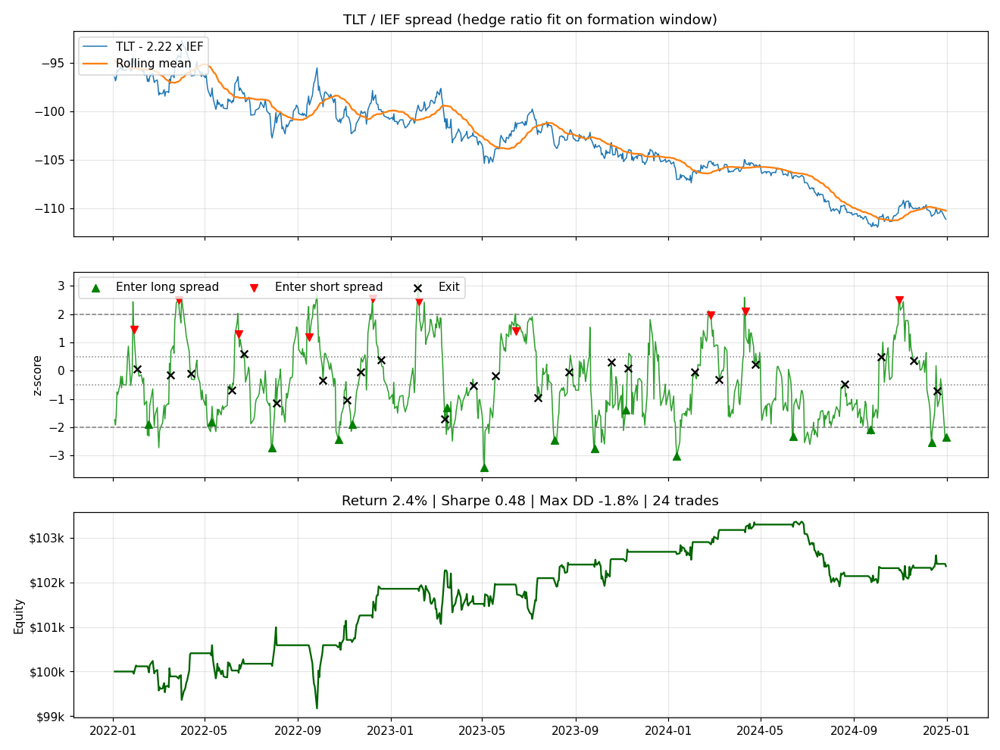

# pair-trading-algorithm

Mean-reversion pairs trading on ETF and stock pairs, tested out of sample. The hedge ratio and the cointegration test use 2019-2021 only, and the strategy is traded on 2022-2024 data it has never seen.



## Method

1. **Formation window (2019-2021).** Regress X on Y with OLS to get the hedge ratio beta, and run an Engle-Granger cointegration test on the pair.
2. **Spread and z-score.** spread = X - beta * Y. The z-score is the spread minus its 30-day rolling mean, divided by its 30-day rolling standard deviation. The rolling window only looks backwards.
3. **Signals.** Go long the spread (long X, short beta shares of Y) when z <= -2, short the spread when z >= 2. Close a long once z gets back above -0.5 and a short once it falls below 0.5.
4. **Execution.** The signal is computed at the close and the position is put on at the next day's close. Chart markers show the day the position is actually put on, which is why some sit inside the bands.
5. **Returns and costs.** Daily P&L is the change in the spread divided by gross exposure (X + |beta| * Y). Each entry and exit costs 5 bps of gross exposure.

## Results

Trading window 2022-01-03 to 2024-12-31, 5 bps per side:

| Pair | Hedge ratio | Coint. p (2019-21) | Coint. p (2022-24) | Return | Sharpe | Max DD | Trades | Win rate | Avg hold (days) |
|---|---|---|---|---|---|---|---|---|---|
| EEM/VWO | 1.04 | 0.96 | 0.51 | -2.4% | -0.92 | -2.9% | 23 | 52% | 14.4 |
| EWZ/EWA | 0.45 | 0.67 | 0.24 | 8.5% | 0.32 | -13.5% | 26 | 62% | 11.8 |
| KO/PEP | 0.26 | 0.19 | 0.81 | -10.8% | -0.87 | -13.9% | 18 | 56% | 20.3 |
| TLT/IEF | 2.22 | 0.50 | 0.89 | 2.4% | 0.48 | -1.8% | 24 | 83% | 12.9 |

Full numbers are in `results/summary.csv` and every trade is in `results/trades_*.csv`.

## What the results say

- **None of the four pairs passes the cointegration test at 5% in the formation window.** A real process would drop all of them before trading. They are traded here anyway to show what happens when the test is ignored.
- **EEM and VWO look like the same fund but are not cointegrated (p = 0.96).** EEM tracks an MSCI index that includes South Korea; VWO tracks a FTSE index that classifies Korea as developed and leaves it out. The spread between them drifts with Korea's relative performance, so it does not reliably mean-revert.
- **Win rate is not edge.** KO/PEP won 56% of its trades and still lost 10.8%: the average winner made 0.6% and the average loser lost 2.2%. TLT/IEF won 83% of trades for only 2.4% over three years.
- **The relationship changes over time.** KO/PEP had the lowest formation p-value (0.19) and the highest in the trading window (0.81). A hedge ratio fit on 2019-2021 did not describe 2022-2024.

## Usage

```
pip install -r requirements.txt
python run.py
python run.py --formation-end 2020-12-31 --lookback 60 --entry-z 2.5 --cost-bps 10
```

Tests use a synthetic cointegrated pair, so they run without downloading data:

```
python -m unittest discover -s tests -t .
```

## Limitations

- One static hedge ratio per pair. A rolling or Kalman-filter hedge ratio would adapt to the kind of drift seen in KO/PEP.
- Returns are on gross exposure and ignore margin, short borrow fees and the cost of rebalancing the hedge.
- Four hand-picked pairs; no systematic pair search, so there is no multiple-testing problem yet, but there would be with one.
